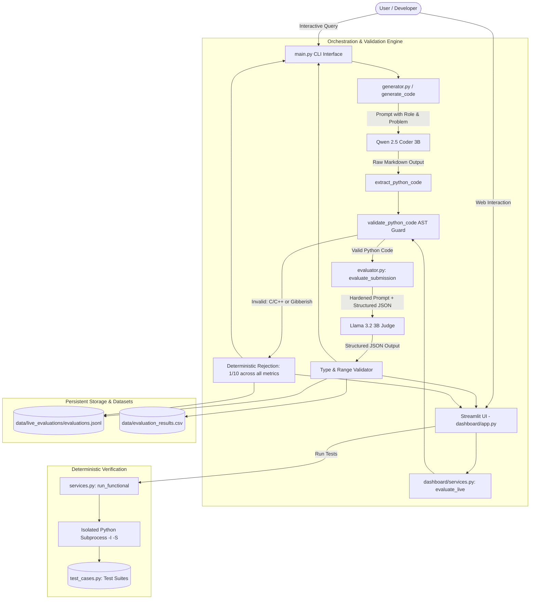

# LLM-as-a-Code-Auditor: In-Depth Technical & Syllabus-Aligned Architectural Report

## Executive Summary & System Overview

**LLM-as-a-Code-Auditor** is an end-to-end applied Generative AI system that implements and evaluates **LLM-as-a-Judge** architectures for automated Python software auditing. 

In automated code generation, traditional compiler passes and linters verify syntactic validity but fail to evaluate semantic design intent, algorithmic complexity, maintainability, and subtle security risks. Conversely, human peer review is slow and cost-prohibitive. This project builds a dual-model pipeline using locally hosted open-weights Large Language Models via Ollama to automate multidimensional code evaluation across:
1. **Correctness** (1–10)
2. **Security** (1–10)
3. **Readability** (1–10)
4. **Efficiency** (1–10)

Crucially, the project does not blindly trust the LLM judge. It treats the judge itself as an experimental subject, benchmarking its scores against:
- **Deterministic ground-truth unit test suites** executed inside isolated subprocess environments.
- **Empirical bias detection frameworks** measuring position bias, verbosity bias, and self-enhancement bias.
- **Syntactic AST validation guards** that prevent LLM hallucination on non-Python or malformed code.

---

## 1. Syllabus Mapping: Concepts Applied in This Project

| Syllabus Unit | Core Theoretical Concepts | Concrete Implementation in This Project |
| :--- | :--- | :--- |
| **Unit 1: Foundations of GenAI & Prompting** | • Decoder-only LLMs<br>• Contextual Embeddings & BPE<br>• Landscape: Llama 3.2 & Qwen 2.5 Coder<br>• Prompt Anatomy (Instructions, Context, Input, Indicators)<br>• Prompting Techniques: Role Prompting, Zero-Shot, Chain-of-Thought (CoT) | • **Dual-LLM deployment** via Ollama: `qwen2.5-coder:3b` (generation specialist) and `llama3.2:3b` (evaluator judge).<br>• **Role Prompting**: System roles defining "Python programming assistant" vs. "independent Python code auditor".<br>• **Prompt Anatomy**: Carefully delimited Problem, Instructions, Target Code, and Output format specifications in `main.py` and `evaluator.py`. |
| **Unit 2: Practical Prompting & Structured Generation** | • Structured Output (JSON, Lists, CSV)<br>• Output parsers & JSON Schema enforcement<br>• Prompt Chaining & Pipeline workflows<br>• Prompting tactics & Classification / Scoring | • **Constrained JSON Generation**: Using Ollama's `format="json"` API enforce strict key-value JSON schema.<br>• **Defensive Schema Parsing**: In-code numeric type guards, range validation `[1, 10]`, and fallback parsers.<br>• **Prompt Chaining**: `Problem -> Generator LLM -> Code Extractor -> Pre-Validation -> Judge LLM -> Aggregator -> Telemetry/JSONL`.<br>• **CSV Data Pipelines**: Ingestion of `questions.csv`, generation of `submissions.csv`, and logging to `evaluation_results.csv`. |
| **Unit 3: Autonomous Agents, Frameworks & Prompt Optimization** | • Agents with tools and execution environments<br>• Programmatic prompt optimization<br>• Iterative refinement & feedback loops<br>• Guardrails and evaluation frameworks | • **Tool & Environment Execution**: `universal_test_runner.py` and `dashboard/services.py` act as sandboxed execution tools executing generated code against test cases.<br>• **Iterative Prompt Refinement**: Removal of positive anchoring bias (`"score": 8` template bug) through empirical error analysis.<br>• **Evaluation Benchmark**: Systematic framework comparing LLM scores with ground truth unit tests. |
| **Unit 4: Building AI-Powered Applications** | • Building full-stack AI-powered applications<br>• Interactive web interfaces<br>• Defensive engineering against jailbreaks / invalid inputs<br>• Subprocess execution and local model orchestration | • **Full-Stack Streamlit Dashboard** (`dashboard/app.py` & `services.py`) with reactive components, real-time Ollama health checks, and visual metric cards.<br>• **AST-level Pre-validation Guards**: Multi-stage regex and Abstract Syntax Tree filtering against foreign languages (C/C++) and gibberish. |

---

## 2. End-to-End System Architecture & Data Flow

The system operates across three tiers: User Interfaces, Orchestration / Evaluation Core, and Local Inference Engine.



---

## 3. Comprehensive Repository Codebase Guide: What Each Python File Does

Below is an exhaustive breakdown of every Python file in the repository, organized by functional subsystems.

### 3.1 Core Auditing Pipeline & User Interfaces

* **`main.py`**:
  * **Role:** The primary entry point and flexible command-line interface (CLI) for end-users and developers.
  * **Functionality:** Provides both an interactive prompt and CLI arguments (`--problem`, `--code`, `--code-file`, `--generator-model`, `--judge-model`). Coordinates code generation, calls `extract_python_code()` to strip markdown wrappers, invokes `validate_python_code()`, dispatches to the judge model, and prints formatted evaluation telemetry.
* **`evaluator.py`**:
  * **Role:** The core point-wise LLM evaluation engine and AST guardrail definition module.
  * **Functionality:** Houses `validate_python_code()` (multi-tier regex and AST syntactic validation), `extract_python_code()` (markdown code fence parser), and `evaluate_submission()`. It constructs the hardened, anti-bias evaluation prompt, calls Ollama in JSON mode, strictly asserts score bounds $[1, 10]$, and handles batch CSV auditing of `data/submissions.csv` writing out to `data/evaluation_results.csv`.
* **`generator.py`**:
  * **Role:** Automated batch Python code generation engine.
  * **Functionality:** Iterates through 20 programming tasks defined in `data/questions.csv`. For each question, it applies three distinct prompting variations (simple/clean, efficient/edge-case handling, and alternative approach) using `qwen2.5-coder:3b`, parses the code blocks, and saves the 60 candidate programs into `data/submissions.csv`.
* **`generate_llama_submissions.py`**:
  * **Role:** Secondary code generation pipeline for cross-model benchmarking.
  * **Functionality:** Generates Python code implementations for all 20 benchmark questions using `llama3.2:3b` rather than Qwen. Outputs to `data/llama_generated_submissions.csv` to allow direct self-enhancement bias testing (Llama judging Llama vs. Llama judging Qwen).

---

### 3.2 Interactive Web Dashboard (`dashboard/`)

* **`dashboard/app.py`**:
  * **Role:** The full-stack interactive Streamlit web application.
  * **Functionality:** Exposes 5 interactive navigation tabs:
    1. *Project Overview:* Research goals, team credentials, model specifications, and high-level pass rates.
    2. *Code Evaluation:* Real-time live code auditor where users input problem descriptions and paste code; includes dynamic model selection and validation alerts.
    3. *Functional Testing:* Interactive test bench where users run submissions against ground-truth unit tests.
    4. *Research Results:* Interactive charts plotting LLM vs. functional accuracy, position bias, and score distributions.
    5. *About the Experiments:* Technical methodologies.
* **`dashboard/services.py`**:
  * **Role:** Backend business logic, telemetry recorder, and sandboxed test execution layer for the dashboard.
  * **Functionality:** Exposes `evaluate_live()` which logs live runs to `data/live_evaluations/evaluations.jsonl`, `available_models()` for dynamic Ollama discovery, and `run_functional()` which executes candidate code within an isolated, resource-constrained Python subprocess (`-I -S`) with strict 3-second timeouts.

---

### 3.3 Functional Testing & Benchmark Ground Truth

* **`benchmark_config.py`**:
  * **Role:** Centralized configuration mapping problem IDs to expected function interfaces and normalization rules.
  * **Functionality:** Defines `FUNCTION_MAP` (allowing alternative function names such as `["factorial", "calculate_factorial"]` generated across prompt variations) and `BENCHMARK_RULES` specifying input/output conventions (e.g. case sensitivity, sorted duplicates).
* **`test_cases.py`**:
  * **Role:** The deterministic ground-truth test suite dictionary.
  * **Functionality:** Contains comprehensive input-output test tuples for all 20 benchmark tasks (P01 to P20), covering normal cases, extreme edge cases (empty strings, zero, negative numbers, singletons), and boundary conditions.
* **`universal_test_runner.py`**:
  * **Role:** Automated batch test harness for Qwen-generated code submissions.
  * **Functionality:** Uses Python AST parsing to isolate target functions and dependencies, dynamically constructs test harness wrappers, executes each test case in a sandboxed subprocess, and generates `data/correctness_results.csv` and `data/correctness_test_details.csv`.
* **`test_llama_submissions.py`**:
  * **Role:** Automated batch test harness for Llama-generated code submissions.
  * **Functionality:** Mirrors `universal_test_runner.py` but executes against `data/llama_generated_submissions.csv`, writing pass/fail ground truth to `data/llama_correctness_results.csv`.
* **`test_submissions.py`**:
  * **Role:** Baseline prototype script for functional testing on initial tasks (P01 primality).
* **`test_prime_fixed.py`**:
  * **Role:** Focused regression test harness for Task P01 (primality checking) handling edge cases like negative inputs and boundary integers.
* **`test_sorting_adapter.py`**:
  * **Role:** Test adapter for Task P05 (sorting algorithms). Resolves differences between mutating in-place sorts and functions that return new lists.
* **`test_parentheses_adapter.py`**:
  * **Role:** Test adapter for Task P16 (balanced parentheses) to evaluate stack algorithms against malformed strings.
* **`test_password_adapter.py`**:
  * **Role:** Test adapter for Task P20 (password validation) reconciling boolean return values vs. descriptive status strings.

---

### 3.4 Bias Measurement & Experimental Studies

* **`pairwise_evaluator.py`**:
  * **Role:** Pairwise comparative preference evaluation engine.
  * **Functionality:** Presents the LLM judge with two competing code solutions (Code A vs. Code B) for the same problem from `data/external_human_dataset/human-preference-alignment.jsonl.gz`. Instructs the judge to select the superior solution (A, B, or Tie) and compares selections against human ground-truth labels.
* **`controlled_position_bias.py`**:
  * **Role:** Controlled order-reversal experiment runner.
  * **Functionality:** Tests for **Position Bias** by evaluating code pairs in `(A, B)` order, then in swapped `(B, A)` order under deterministic settings (`temperature=0, seed=42`). Calculates the exact percentage of instances where the judge reverses its preference solely due to input order.
* **`position_bias_evaluator.py`**:
  * **Role:** Alternative position bias pipeline measuring first-position selection rates on human datasets.
* **`controlled_verbosity_scoring.py`**:
  * **Role:** Controlled test harness for **Verbosity Bias**.
  * **Functionality:** Takes clean code submissions and creates synthetic variants by injecting elaborate explanatory docstrings and commentary without changing functional logic. Scores both variants with Llama 3.2 3B to detect whether the judge inflates scores for longer/comment-heavy code.
* **`neutral_verbosity_scoring.py`**:
  * **Role:** Randomized, balanced verbosity experiment runner alternating the presentation order of concise vs. verbose implementations to eliminate position confounding.
* **`verbosity_bias_evaluator.py`**:
  * **Role:** Pairwise verbosity tournament judge selecting preferences between concise vs. comment-padded solutions.
* **`self_enhancement_evaluator.py`**:
  * **Role:** Pairwise **Self-Enhancement Bias** evaluator.
  * **Functionality:** Pairs a Qwen-generated solution with a Llama-generated solution for the same task and asks Llama 3.2 3B to judge which is superior. Compares preference rates to detect in-family model favoritism.
* **`self_enhancement_pointwise.py`**:
  * **Role:** Point-wise variant of self-enhancement testing comparing absolute dimension scores assigned by Llama to its own code versus code generated by Qwen.

---

### 3.5 Analysis, Inspection & Human Alignment Tools

* **`analyze_all_dimensions.py`**:
  * **Role:** Statistical profiling utility across all 4 evaluation dimensions.
  * **Functionality:** Computes mean, standard deviation, min, max, and unique value distributions for Correctness, Security, Readability, and Efficiency from `data/evaluation_results.csv`.
* **`analyze_score_distribution.py`**:
  * **Role:** Granular distribution analyzer calculating frequency histograms of assigned judge scores.
* **`analyze_pairwise_results.py`**:
  * **Role:** Evaluates judge-human alignment by computing agreement percentages between LLM pairwise choices and human consensus annotations.
* **`analyze_qwen_reliability.py`**:
  * **Role:** Cross-references Qwen code evaluations against functional test outcomes to calculate false-positive and false-negative audit rates.
* **`analyze_self_enhancement.py`**:
  * **Role:** Computes summary statistics on whether Llama preferentially rated Llama-authored code over Qwen-authored code.
* **`compare_llm_vs_functional.py`**:
  * **Role:** Generates correlation matrices and scatter-plot data linking the judge's subjective Correctness score against objective test pass percentages.
* **`final_research_analysis.py`**:
  * **Role:** Master charting and visualization script.
  * **Functionality:** Uses `matplotlib` and `seaborn` to render and save all publication-grade figures in `data/final_graphs/` (e.g. score distributions, position sensitivity bars, pass rate comparisons).
* **`create_human_template.py`**:
  * **Role:** Generates standardized annotation templates (`data/human_annotations.csv`) for human reviewers.
* **`create_reviewer_files.py`**:
  * **Role:** Generates formatted multi-tab Excel review workbooks with instructions, rubrics, and submission slices for human grading teams.
* **`inspect_submissions.py`**:
  * **Role:** Command-line preview tool to inspect generated submission records and code blocks.
* **`inspect_interfaces.py`**:
  * **Role:** AST analysis script scanning all generated submissions to identify defined function names and argument signatures.
* **`inspect_failures.py`**:
  * **Role:** Diagnostic tool filtering and displaying all submissions that failed functional test suites.
* **`inspect_returns.py`**:
  * **Role:** Inspects runtime return types of candidate functions to identify type mismatches against test assertions.
* **`inspect_external_dataset.py`**:
  * **Role:** Validates structure and headers of the external human preference benchmark dataset.
* **`check_p05_syntax.py` & **`check_p16_syntax.py`**:
  * **Role:** Focused syntactic AST integrity checkers for complex sorting and stack problem submissions.

---

### 3.6 Automated Unit Tests (`tests/`)

* **`tests/__init__.py`**:
  * **Role:** Declares the `tests/` directory as a standard Python test package.
* **`tests/test_validation.py`**:
  * **Role:** Automated unit test suite verifying language enforcement, boundary protection, and AST validation.
  * **Functionality:** Contains 7 standalone test methods using Python's `unittest` framework:
    * `test_rejects_empty_and_whitespace`: Ensures empty submissions are rejected.
    * `test_rejects_bare_identifier_and_literals`: Verifies that gibberish like `"abcd"` or numbers like `12345` are rejected.
    * `test_rejects_c_and_cpp_code`: Asserts that C/C++ code (`#include`, `int main()`, `printf()`, `malloc`) is intercepted.
    * `test_rejects_syntax_errors`: Confirms broken Python syntax is caught.
    * `test_accepts_valid_python`: Confirms valid functions, classes, and markdown-wrapped code are accepted.
    * `test_evaluate_submission_rejects_abcd`: Verifies deterministic 1/10 scoring on gibberish.
    * `test_evaluate_submission_rejects_c_code`: Verifies deterministic 1/10 scoring on C snippets.

---

## 4. Key Improvements and Iterations Log

| Stage | Observation / Vulnerability | Root Cause | Implemented Solution |
| :--- | :--- | :--- | :--- |
| **Initial Prototype** | `main.py` had hardcoded models and crashed if models weren't accessible via CLI. | Rigid programmatic constants; no CLI arguments. | Implemented `argparse` in `main.py` supporting `--problem`, `--code`, `--code-file`, `--judge-model`, and `--generator-model`. |
| **Leniency Vulnerability** | Inputting `"abcd"` yielded an **8/10 score** from Llama 3.2 3B. | Prompt template schema had `"score": 8` in the example; model anchored to default value. | Stripped numerical anchor to neutral `"score": 1`, added strict tier descriptions and AST pre-validation. |
| **Language Boundary Issue** | C code with `#include` and `int main()` was evaluated without error. | The evaluator assumed all incoming text was Python code. | Implemented `validate_python_code()` regex + AST filter to reject foreign languages. |
| **Over-strict Parsing Bug** | Model-generated valid Python code was given a **1/10 score** for `SyntaxError at line 1`. | Conversational introduction text (`"Certainly! Here is your code..."`) was parsed directly as code. | Added `extract_python_code()` regex to isolate the code payload inside fenced blocks. |
| **Testing Coverage** | No automated tests existed to verify validation boundaries. | Reliance on manual UI testing. | Added `tests/test_validation.py` running 7 test suites via `unittest`. |

---

## 5. How to Run and Verify the System

### 5.1 CLI Execution
```powershell
# Interactive mode:
python main.py

# Audit specific problem and code snippet:
python main.py --problem "Add two numbers" --code "def add_numbers(a, b): return a + b"

# Test rejection on C code:
python main.py --problem "Add two numbers" --code "#include <stdio.h>`nint main() { return 0; }"
```

### 5.2 Automated Unit Testing
```powershell
python -m unittest discover -s tests -v
```

### 5.3 Web Dashboard Launch
```powershell
python -m streamlit run dashboard/app.py
```

---

## 6. Conclusion

By combining **Foundational GenAI concepts** (Tokenization, Local Model Orchestration, Role Prompting), **Structured Output Engineering** (JSON schema validation, defensiveness), and **Application-level Guardrails** (AST checking, Subprocess sandboxing, and Bias testing), this project proves that automated LLM evaluation can be made reliable, secure, and resilient against hallucination.
